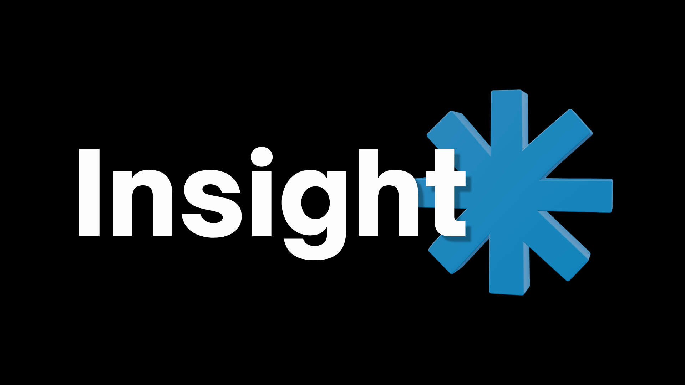
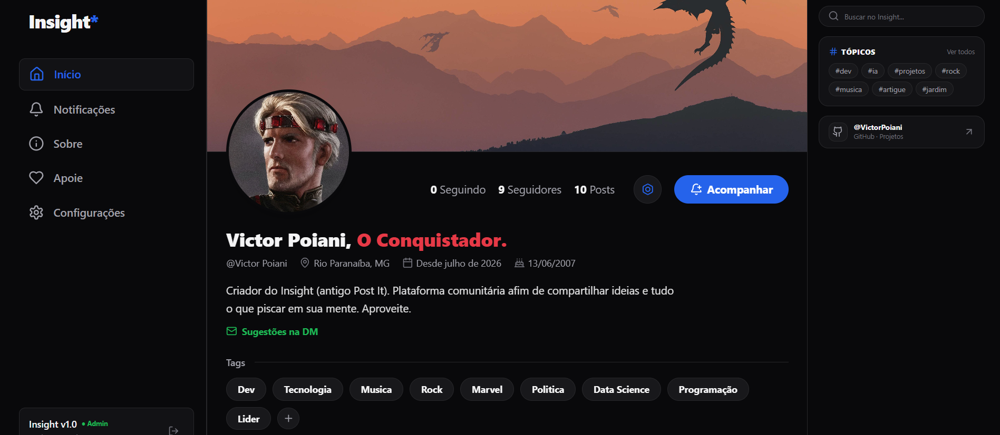
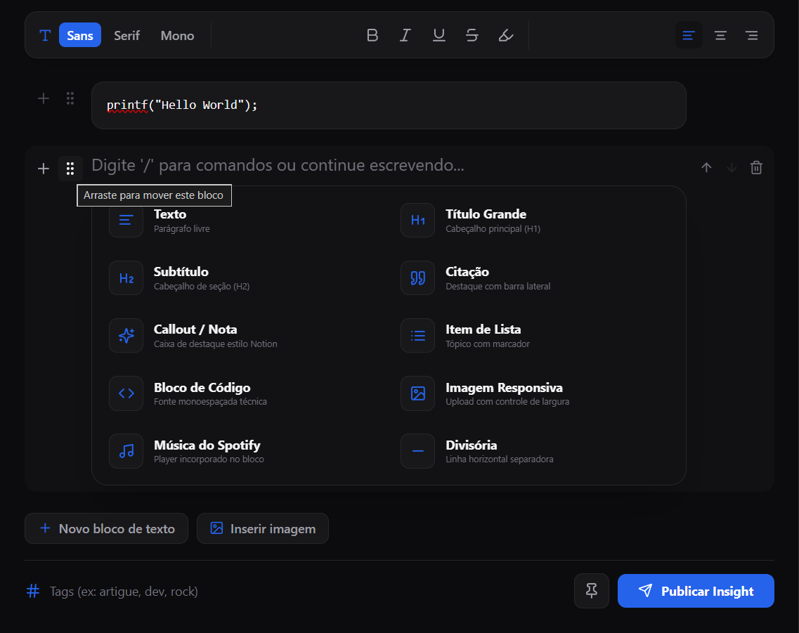
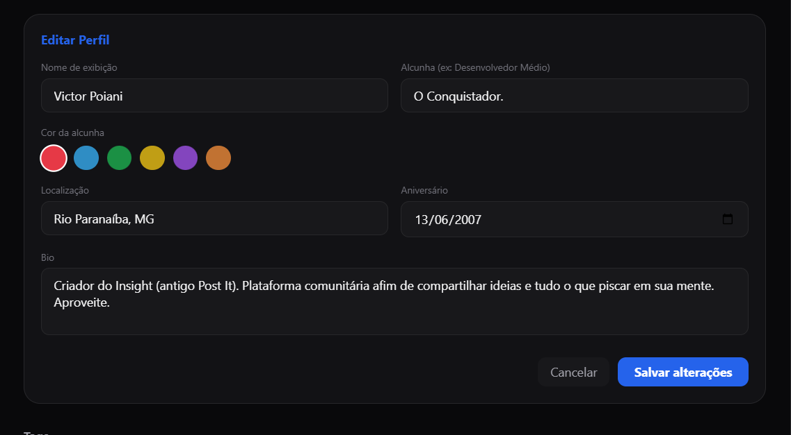
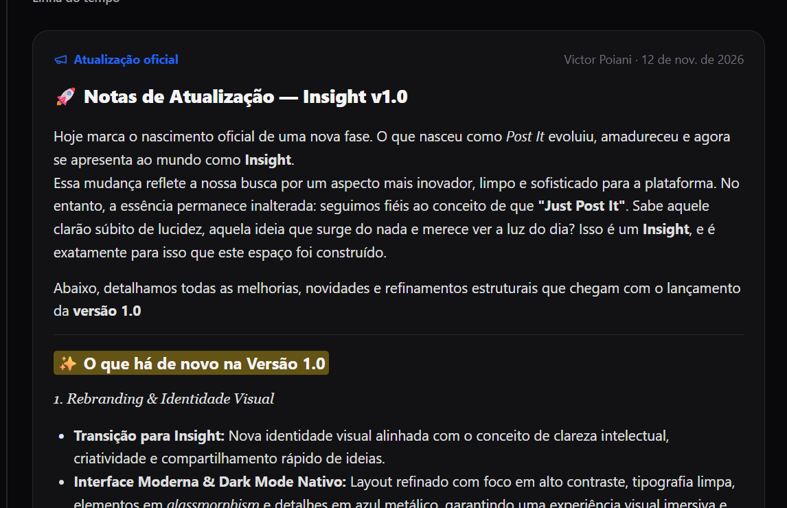
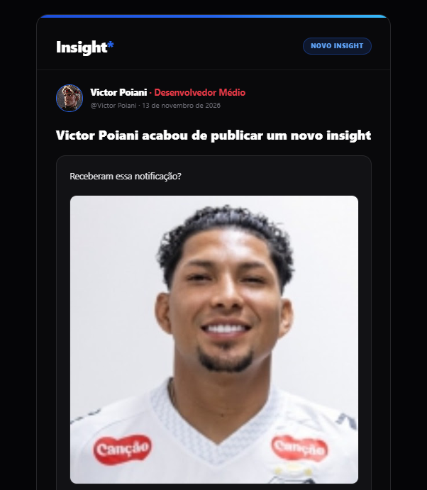

<!-- 🖼️ IMAGEM DE CAPA / BANNER DO PROJETO -->
<!-- Substitua o link abaixo pelo caminho da sua imagem (ex: ./public/screenshots/banner-insight.png) -->

 
 

# Insight*

### *"Apenas poste."*

**Uma plataforma autoral de microblogging, escrita modular e curadoria de ideias.**  
Onde a agilidade de uma thread encontra a liberdade criativa de um editor rico em blocos.

[Explorar Plataforma](#) · [Mural Oficial](#) · [Apoiar o Projeto](#)

---

## 💡 A Filosofia do Insight*

Redes sociais tradicionais limitam ideias complexas a caixas de texto simples, enquanto blogs convencionais exigem uma estrutura pesada demais para pensamentos rápidos.

O **Insight\*** (anteriormente *Post it*) nasceu sob o lema **"Apenas poste."** — um espaço digital construído para oferecer **liberdade criativa total**: você pode publicar desde uma reflexão curta de duas linhas até um artigo técnico completo com blocos de código, citações, galerias de imagens, trilhas sonoras do Spotify e tópicos personalizados, tudo no mesmo feed interativo.

---

## 🖼️ Visão Geral da Interface (Screenshots)

> 📌 *Espaço reservado para imagens representativas da plataforma. Salve seus prints na pasta `public/screenshots/` com os nomes abaixo (ou arraste as imagens diretamente ao editar este README no GitHub).*

  
  <strong>Feed Principal:</strong> Visual Dark Mode de alto contraste, publicações em destaque, tópicos em alta e navegação fluida.

 

| 🎨 Editor Criativo & Blocos | 👤 Perfil Personalizado & Banner |
| :---: | :---: |
|  |  |
| *Composição livre com títulos, callouts, código, imagens e Spotify.* | *Identidade visual própria com avatar, apelido, handle e card estilizado.* |

| 🏷️ Criação de Tópicos & Threads | 🔔 Mural Oficial & Configurações |
| :---: | :---: |
|  |  |
| *Filtragem dinâmica por `#hashtags` e cards expansíveis de resposta.* | *Linha do tempo oficial da plataforma e central de preferências.* |

---

## ✨ Experiência & Funcionalidades da Plataforma

### 🎨 1. Liberdade Criativa & Editor Modular em Blocos
No **Insight\***, cada publicação é uma tela em branco. Em vez de um campo de texto engessado, o autor estrutura o pensamento combinando blocos independentes (`PostBlock`):
- **Tipografia Hierárquica (`H1` e `H2`):** Estruture artigos, tutoriais e ensaios com títulos e subtítulos claros.
- **Caixas de Destaque (`Callout`):** Destaque insights importantes, dicas ou avisos com ícones personalizados (`💡`, `🔥`, `⚡`).
- **Citações Editoriais (`Quote`):** Blocos estilizados com barra lateral azul metálica para destacar trechos de livros, referências ou frases marcantes.
- **Blocos de Código (`Code`):** Formatação monoespaçada com alto contraste para compartilhar snippets de programação.
- **Mídia Visual com Legenda (`Image`):** Upload e exibição de imagens com bordas arredondadas e suporte a legendas descritivas (`imageCaption`).
- **Listas (`Bullet`) & Divisores (`Divider`):** Organização visual limpa para separar seções dentro do mesmo post.
- **Trilha Sonora Integrada (`Spotify API`):** Incorpore músicas, álbuns ou podcasts diretamente na publicação para criar uma experiência imersiva de leitura e áudio.

---

### 🏷️ 2. Criação de Tópicos, Curadoria & Threads Interativas
A organização do conhecimento no **Insight\*** é orgânica e guiada por temas criados na hora da publicação:
- **Criação Livre de Tópicos (`#tags`):** Crie e associe múltiplas hashtags a qualquer postagem para agrupar ideias por área (ex.: `#tecnologia`, `#filosofia`, `#projetos`, `#musica`).
- **Filtragem Inteligente por Tema:** Os leitores podem navegar por tópicos específicos e configurar a plataforma para acompanhar apenas os assuntos que mais importam.
- **Insights Fixados (`Pinned Posts`):** Destaque as publicações mais relevantes no topo do feed com selo especial de destaque.
- **Cards Expansíveis & Respostas em Thread:** Interação direta nas publicações através de um mecanismo fluido de expansão de cards para leitura e envio de respostas sem perder o contexto do feed.

---

### 👤 3. Personalização de Perfil & Identidade do Autor
Cada membro possui uma presença digital única dentro da plataforma, desenhada com estética inspirada em *trading cards* e acabamento em azul metálico:
- **Identidade Completa:** Configuração personalizada de **Nome de Exibição** (`display_name`), **Apelido/Título** em destaque (`nickname`, ex.: *· o criador*), **Handle único** (`@username`) e biografia.
- **Avatar & Visual Customizado:** Upload de foto de perfil com moldura em destaque e layout de cabeçalho estilizado.
- **Preferências de Experiência (`/config`):** Painel dedicado para o usuário gerenciar seus dados, ajustar filtros de conteúdo e controlar suas notificações em tempo real.

---

### 📬 4. Newsletter Inteligente Sob Medida (`/api/newsletter`)
O **Insight\*** transforma publicações do feed em boletins editoriais enviados diretamente para o e-mail dos leitores, respeitando o filtro escolhido por cada inscrito:

  <!-- 🖼️ IMAGEM REPRESENTATIVA DO E-MAIL / NEWSLETTER -->
  
   
  Template HTML Dark Mode gerado automaticamente a partir dos blocos do post.

 

- **4 Modos de Assinatura Personalizáveis:**
  - ✨ **Todas as publicações (`all`):** Recebe cada novo insight publicado no feed + comunicados oficiais.
  - 📌 **Apenas Destaques (`pinned`):** Recebe somente publicações fixadas pelo autor + comunicados oficiais.
  - 🏷️ **Por Tópicos (`tags`):** O assinante escolhe suas `#hashtags` favoritas e só recebe e-mails quando um post abordar esses temas.
  - 🔒 **Somente Atualizações Oficiais (`official_only`):** Recebe apenas avisos institucionais da plataforma.
- **Boas-Vindas Automatizadas:** Ao se inscrever, o leitor recebe imediatamente um e-mail com o resumo do seu filtro ativo e uma prévia do último Insight em destaque no blog.
- **Motor Híbrido de Disparo:** Integração automática via **Gmail SMTP (Nodemailer)** para alcance irrestrito de destinatários, com fallback para **Resend API**.

---

### 🔔 5. Mural Oficial, Apoio & Transparência
- **Mural Oficial (`/notificacoes`):** Linha do tempo dedicada a *changelogs*, novidades de recursos e comunicados oficiais do projeto.
- **Apoie o Projeto (`/apoie`):** Página responsiva para contribuições voluntárias e incentivo à manutenção da infraestrutura.
- **Governança & Conformidade Legal (`/termos` e `/privacidade`):** Termos de Uso e Política de Privacidade em padrão corporativo v2.0, adequados ao **Marco Civil da Internet** e à **LGPD**.

---

## 🛠️ Arquitetura & Stack Tecnológica

| Camada | Tecnologias Utilizadas |
| :--- | :--- |
| **Front-end & Framework** | Next.js 15 (App Router), React, TypeScript |
| **Design System & UI** | Tailwind CSS, Estética Dark Mode (`#050507` / `#09090b` / `#2563eb`), Lucide Icons |
| **Back-end & Banco de Dados** | Next.js Serverless Routes, Supabase (PostgreSQL, Auth, Storage, Row Level Security) |
| **Mídia & E-mail** | Spotify Embed API, Nodemailer (Gmail SMTP) & Resend API |
| **Hospedagem & CI/CD** | GitHub + Vercel |

---